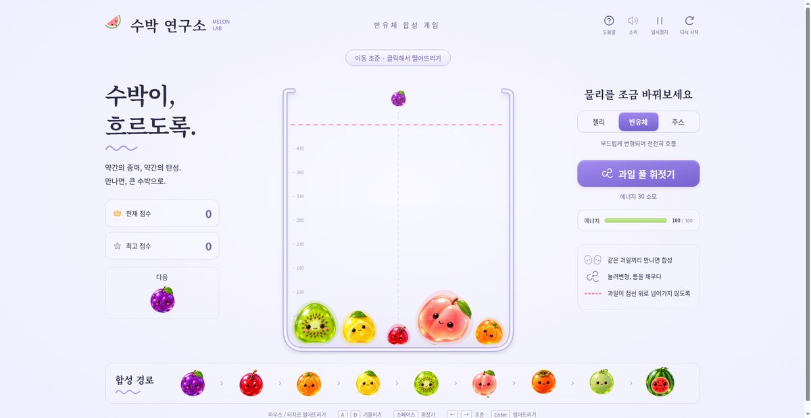

# 🍉 수박 연구소 · 반유체 수박 게임

> 🍉 수박 게임(瓜体实验室 · 멜론 연구소)의 **한글화 포크**입니다.
> 원본은 [Ayi1337/gpt6-astra-one-shot-games](https://github.com/Ayi1337/gpt6-astra-one-shot-games)의 GPT-6 Astra · One Shot 게임 테스트 산출물 중 한 편이며, 본 저장소는 그중 수박 게임 한 편만 가져와 한국어로 완전히 번역했습니다.

라이브 데모 : https://sigco3111.github.io/watermelon-lab/

[](https://sigco3111.github.io/watermelon-lab/)

---

## 📸 실제 실행 화면



---

## 🎮 게임 소개

부드러운 과일을 떨어뜨려 같은 종류끼리 **합성**하고, 최종적으로 **흐르는 큰 수박** 한 알을 만들어내는 물리 기반 캐주얼 퍼즐 게임입니다.

| | |
|---|---|
| 🧪 **장르** | 2D 캐주얼 · 물리 퍼즐 · 합성 |
| 🖼 **렌더링** | HTML5 Canvas 2D |
| 🔊 **오디오** | Web Audio API (생성형 효과음) |
| 🧱 **물리** | 자체 구현 부드러운 입자 시뮬레이션 (반유체·젤리·주스 모드) |
| 📱 **호환** | 데스크톱 / 모바일 (마우스, 키보드, 터치) |
| 📦 **배포** | GitHub Pages (단일 HTML, 빌드 불필요) |

### 🌟 주요 특징

- **반유체 물리**: 일반적인 물리 게임과 달리, 과일이 서로 부딪히면 **눌리고, 늘어나고, 합쳐집니다**.
- **3가지 유동성 모드**: 「젤리 / 반유체 / 주스」 전환으로 한 판 안에서 물성을 바꿀 수 있습니다.
- **다단 합성**: 포도 → 체리 → 귤 → 레몬 → 키위 → 복숭아 → 단감 → 멜론 → **수박** (9단계)
- **콤보 시스템**: 빠른 시간 안에 합성할수록 추가 점수
- **다이얼로그 & 튜토리얼**: 게임 흐름에 맞춰 키 안내와 팁 제공

---

## 🕹 조작법

| 동작 | 키보드 | 마우스 / 터치 |
|---|---|---|
| 좌우 조준 | `←` / `→` 또는 `A` / `D` | 좌우 드래그 |
| 과일 투입 | `Enter` 또는 `Space` | 클릭 / 손 떼기 |
| 풀 기울이기 (누르고 있기) | `A` / `D` 꾹 누르기 | — |
| 풀 휘젓기 | `Space` (에너지 30 소모) | — |
| 일시정지 | `P` 또는 헤더 버튼 | 헤더 버튼 |

> 📝 한글화 과정에서 안내 문구와 키 라벨은 한국어로 모두 번역했습니다.

---

## 🎯 게임 규칙

1. 화면 위쪽의 **다음 과일** 표시를 확인합니다.
2. 좌우로 움직여 떨어뜨릴 위치를 조준합니다.
3. **같은 종류의 과일**이 부딪히면 자동으로 합쳐져 한 단계 위의 과일이 됩니다.
4. **수박**(최종 단계)을 만들면 추가 점수 + 콤보 보너스.
5. **과일이 점선 위로 3초간 머무르면** 라운드 종료.
6. 수박을 한 번이라도 합성한 후라면 **계속 도전** 가능.

### 💡 물리 모드

| 모드 | 효과 |
|---|---|
| 🟢 **젤리** | 탱글한 탄성, 부딪히면 살짝 튕김 |
| 🟡 **반유체** | 부드럽게 변형되며 천천히 흐름 |
| 🔴 **주스** | 낮은 장력, 펼쳐져서 틈을 채움 |

---

## 🚀 실행 방법

### 온라인 (권장)

라이브 데모 : https://sigco3111.github.io/watermelon-lab/

### 로컬에서 직접 열기

```bash
git clone https://github.com/sigco3111/watermelon-lab.git
cd watermelon-lab
open index.html        # macOS
xdg-open index.html    # Linux
start index.html       # Windows
```

빌드 도구, 패키지 매니저, 런타임 설치는 **불필요**합니다. 단일 HTML 파일 하나로 완결됩니다.

---

## 🛠 한글화 노트

원본은 중국어(zh-CN) 인터페이스였습니다. 이 저장소는 다음 원칙으로 한글화했습니다.

| 영역 | 처리 |
|---|---|
| 게임 제목 / 슬로건 | 완전 한국어 번역 |
| 본문 UI 텍스트 (97개 구간) | 한자 → 한국어 1:1 치환 |
| 조작 키 라벨 (`A`/`D`/`Space`/`P` 등) | 키 자체는 영문 유지, 안내 문구는 한국어 |
| 과일 이름 | 葡萄 → 포도, 樱桃 → 체리, 蜜桃 → 복숭아, 西瓜 → 수박 등 9종 |
| 물성 모드명 | 果冻 → 젤리, 半流体 → 반유체, 果汁 → 주스 |
| 다이얼로그 문구 | 자연스러운 한국어 게임 문체로 의역 |
| `aria-label`, `textContent` | 모두 한국어 |
| `<html lang>` | `zh-CN` → `ko` |
| `<title>` | 한국어 번역 적용 |
| 식별자 (변수명 / 함수명 / 주석) | 원본 유지 (수정 불필요, 한자 없음) |
| 인코딩 / 물리 로직 / 이미지 | **그대로 보존** |

번역 후 검증:
- 한자 잔여: **0자**
- 중국식 문장부호 (，`등): **0개**
- `<html lang="ko">` + 한글 `<title>` 적용

---

## 📂 파일 구조

```
watermelon-lab/
├── index.html              # ⭐ 한글화된 게임 (GitHub Pages 진입점)
├── melon-original.html     # 원본 중국어 빌드 결과물 (참고용 보존)
└── README.md
```

> ℹ️ 원본 저장소는 5.2MB 단일 HTML 한 파일로 게임이 완결됩니다. 한글화 시에도 동일한 단일 파일 구조를 유지해 Pages 배포 단순성을 보존했습니다.

---

## 🙏 크레딧

- **원작**: [Ayi1337/gpt6-astra-one-shot-games](https://github.com/Ayi1337/gpt6-astra-one-shot-games)
  - "GPT-6 Astra의 One Shot 게임 디자인 능력 테스트"의 두 산출물 중 하나
  - 원본 Prompt: *"최단 시간에 완전히 새로운 개념의 (물리적 특성을 가진) 반유체 수박 게임을 디자인하라 (HTML 게임)"*
- **한글화**: sigco3111

---

## 📄 라이선스

원본 저장소는 라이선스를 명시하지 않았습니다. 한글화 버전도 동일한 조건을 따릅니다.
